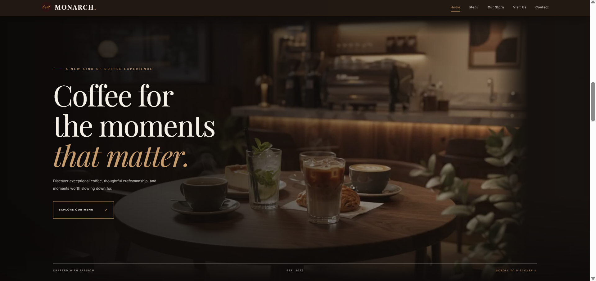
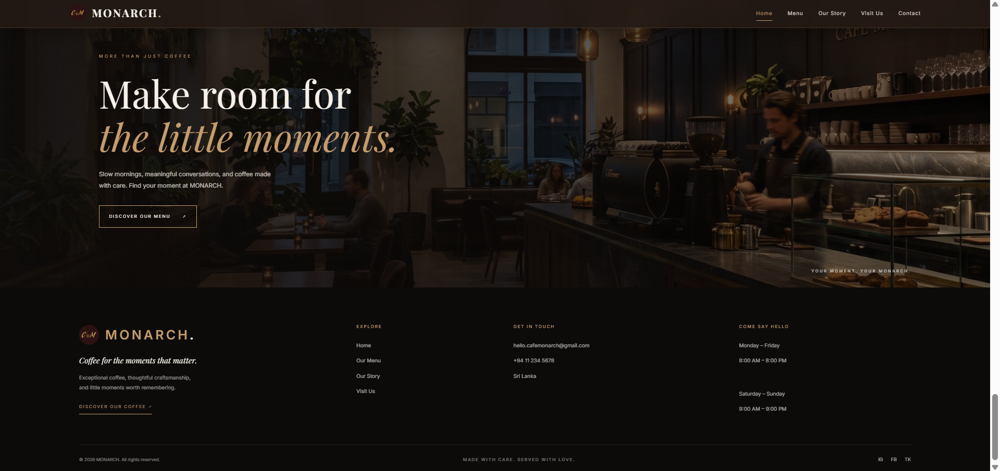
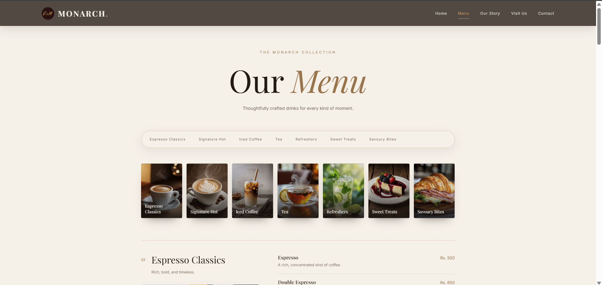
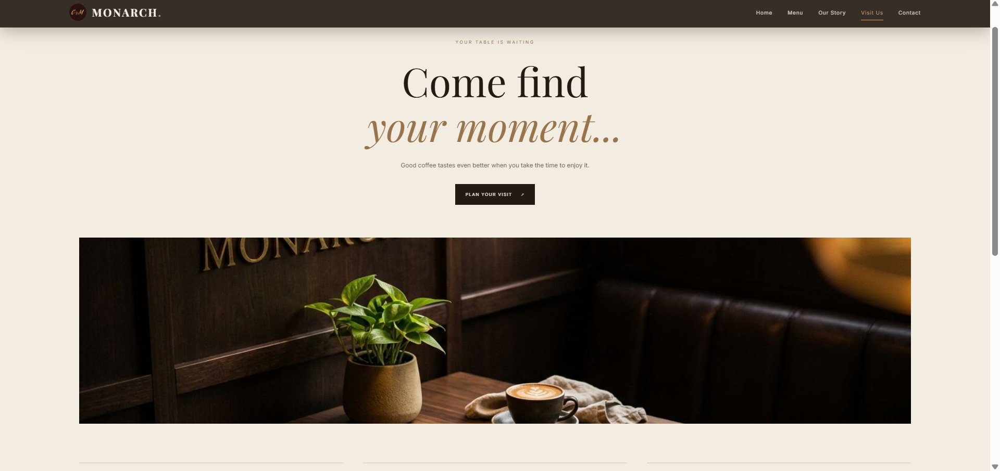
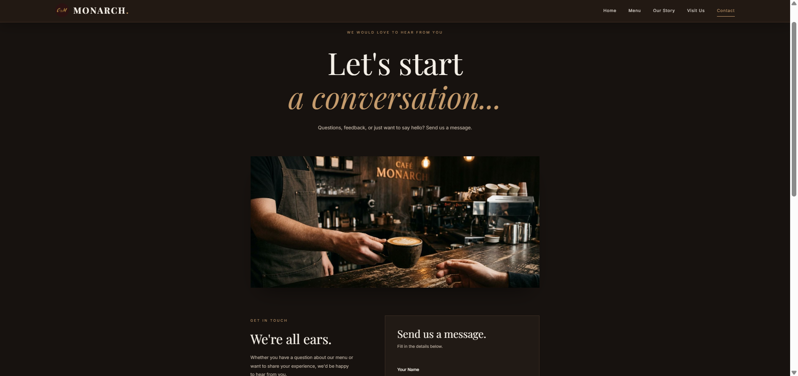
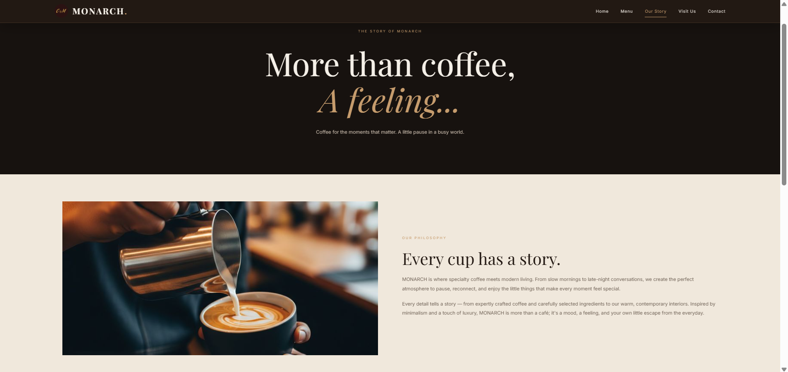

<div align="center">


# MONARCH — Modern Cafe Website ☕

**Coffee for the moments that matter.**

A contemporary café website concept built with React, Vite, and CSS, combining cinematic visuals, an editorial-inspired menu, and a warm, premium digital experience.

[Overview](#overview) · [Visual Highlights](#visual-highlights) · [Features](#key-features) · [Pages](#website-pages) · [Technology](#technology-stack) · [Roadmap](#planned-enhancements)

</div>

---

## Overview

MONARCH is a multi-page café website concept designed around a refined coffee-house identity. Its visual direction pairs espresso-inspired tones and warm neutrals with café photography, atmospheric video, spacious layouts, and subtle motion.

Visitors can discover the café concept, explore its menu, learn about its philosophy, find visit information, and contact the team.

* **Project type:** Front-end web development
* **Status:** In development
* **Concept location:** Colombo, Sri Lanka

## Visual Highlights

<p align="center">
  
</p>

<p align="center"><em>Homepage visual direction — cinematic café atmosphere and coffee-inspired styling.</em></p>

<table>
  <tr>
    <td width="50%">
      
      <p align="center"><strong>Home</strong></p>
    </td>
    <td width="50%">
      
      <p align="center"><strong>Footer</strong></p>
    </td>
  </tr>
  <tr>
    <td width="50%">
      
      <p align="center"><strong>Menu & Coffee Selection</strong></p>
    </td>
    <td width="50%">
      
      <p align="center"><strong>Visit Us</strong></p>
    </td>
  </tr>
  <tr>
    <td width="50%">
      
      <p align="center"><strong>Contact Us</strong></p>
    </td>
    <td width="50%">
      
      <p align="center"><strong>Our Story</strong></p>
    </td>
  </tr>
</table>

## Key Features

* **Cinematic homepage-** Atmospheric café video with a poster image fallback.
* **Category-based menu-** Espresso classics, signature hot coffees, iced coffee creations, tea and botanical infusions, refreshing drinks, sweet treats, and savoury bakes.
* **Five dedicated pages-** Home, Menu, Our Story, Visit Us, and Contact.
* **Visual storytelling-** Café photography, category-specific video content, and image-led sections.
* **Interactive details-** Reveal-on-scroll effects, hover treatments, and tilt-card styling.
* **Responsive navigation-** Collapsible mobile menu, scroll-aware header styling, and keyboard support for closing the menu with Escape.
* **Reusable React components-** Shared navigation, footer, hero, coffee cards, menu media, and story sections.
* **Menu browsing-** Category jump links, descriptions, imagery, and displayed prices.
* **Contact form interface-** Required name, email, subject, and message fields with a submission confirmation.
* **Client-side navigation-** React Router routes and scroll-to-top behaviour between pages.
* **Café-focused visual identity-** Deep coffee tones, warm neutrals, expressive headings, and contemporary layouts.
* **Google Maps integration-** Displays an embedded Google Map on the Visit Us page using the Google Maps Embed API.
* **Google Maps directions-** Provides links to Google Maps so visitors can view the café location and plan their route.

## Website Pages

| Page      | Route      | What visitors can explore                                                                            |
| --------- | ---------- | ---------------------------------------------------------------------------------------------------- |
| Home      | `/`        | Café introduction, featured coffee cards, roasting story, and coffee experience sections             |
| Menu      | `/menu`    | Menu categories, descriptions, prices, images, and related video content                             |
| Our Story | `/story`   | Café philosophy and the values behind the MONARCH concept                                            |
| Visit Us  | `/visit`   | Café location information, opening hours, an embedded Google Map, and directions through Google Maps |
| Contact   | `/contact` | Contact information and a message form                                                               |

## Technology Stack

* **React** — Component-based user interface
* **Vite** — Development server and production build tooling
* **JavaScript (ES Modules) and JSX** — Application logic and page structure
* **CSS** — Responsive layouts, styling, transitions, and visual effects
* **React Router** — Client-side navigation between pages
* **HTML5 Video** — Atmospheric homepage and menu-category videos
* **ESLint** — Code-quality and consistency checks
* **Google Maps Embed API** — Displays the café location in an interactive embedded map

## Project Structure

```text
Cafe_Monarch-Modern_website/
├── public/
│   ├── images/                  # Logo, café photography, menu and page images
│   │   └── readme/              # Images for the README
│   └── videos/                  # Homepage and menu-category videos
├── src/
│   ├── components/
│   │   ├── CoffeeCards.jsx
│   │   ├── CoffeeExperience.jsx
│   │   ├── Footer.jsx
│   │   ├── Hero.jsx
│   │   ├── MenuMedia.jsx
│   │   ├── MenuPhotoStrip.jsx
│   │   ├── Navbar.jsx
│   │   ├── Reveal.jsx
│   │   ├── RoastingStory.jsx
│   │   ├── ScrollToTop.jsx
│   │   └── TiltCard.jsx
│   ├── data/
│   │   └── menuData.js           # Menu category and item data
│   ├── pages/
│   │   ├── Home.jsx
│   │   ├── Menu.jsx
│   │   ├── Story.jsx
│   │   ├── Visit.jsx
│   │   └── Contact.jsx
│   ├── App.jsx                   # Application routes
│   ├── index.css                 # Global styles
│   └── main.jsx                  # Application entry point
├── .env
├── .gitignore
├── index.html
├── package.json
├── package-lock.json
├── vite.config.js
├── eslint.config.js
└── README.md
```

Component and page-specific CSS files sit alongside their related JSX files.

## Planned Enhancements

* **Contact form integration:** Connect the current front-end form to a service or backend so messages can be delivered instead of only showing a confirmation.
* **Further refinement:** Continue improving accessibility, responsive behaviour, and the overall visitor experience.

---

<div align="center">

**MONARCH** · A modern café website concept

</div>
